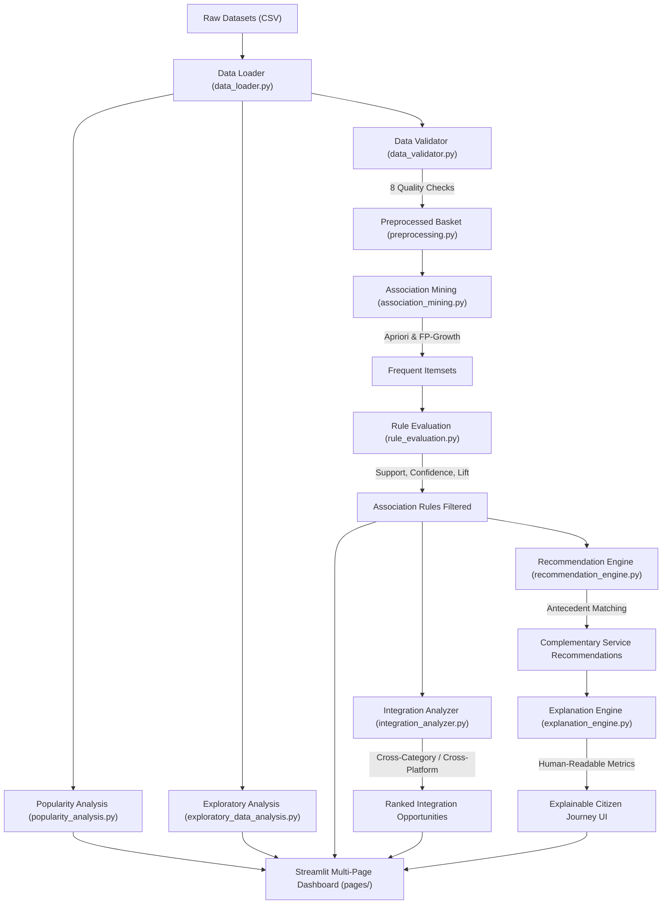

# Project KRATOS — Software & Analytical Architecture

## 1. System Vision & Architecture Principles

Project KRATOS is designed as a modular, extensible, and mathematically rigorous analytics platform for discovering and recommending complementary government digital services.

### Core Architectural Tenets
1. **Separation of Concerns**: Core analytical algorithms reside exclusively in `modules/` and have zero dependencies on Streamlit or web UI frameworks.
2. **Framework Agnostic Core**: The analytical layer takes standard Python / Pandas data structures and returns pure dictionaries or DataFrames. This enables future migration to FastAPI / React without modifying analytical modules.
3. **Reproducibility & Statistical Integrity**: All metrics (support, confidence, lift, opportunity score) are computed deterministically using standard mathematical formulations.
4. **Non-Causal & Co-Usage Framing**: Models uncover symmetric/asymmetric co-occurrence associations. Results are strictly framed as complementary recommendations, never chronological next-step predictions.

---

## 2. Pipeline Architecture

---

## 3. Module Specifications & Responsibilities

| Module | Core Functions | Output Artifacts | Future FastAPI Mapping |
|:---|:---|:---|:---|
| `data_loader.py` | `load_csv()`, `load_all_datasets()` | Dictionary of DataFrames | Database / Cache repository |
| `data_validator.py` | `validate_datasets()` | DataFrame of 8 quality check statuses | Ingestion health checks / `/health/data` |
| `preprocessing.py` | `prepare_basket_data()` | Binary matrix (N x M) | Data transformation pipeline |
| `popularity_analysis.py` | `calculate_service_popularity()` | Ranked popularity DataFrame | `GET /api/v1/popularity` |
| `exploratory_data_analysis.py` | `get_service_distribution()`, etc. | Distribution summaries | `GET /api/v1/eda/*` |
| `association_mining.py` | `run_apriori()`, `run_fpgrowth()`, `compare_algorithms()` | Frequent itemsets with execution metrics | `POST /api/v1/mining/frequent-itemsets` |
| `rule_evaluation.py` | `generate_rules()`, `calculate_lift_survival()` | Association rules DataFrame with metrics | `POST /api/v1/mining/rules` |
| `integration_analyzer.py` | `analyze_integration_opportunities()` | Ranked opportunities with composite scores | `POST /api/v1/insights/integration` |
| `recommendation_engine.py` | `recommend_services()` | Ranked complementary service recommendations | `POST /api/v1/recommend` |
| `explanation_engine.py` | `generate_explanation()` | Human-readable explanation strings and metrics | Integrated in `/recommend` response |

---

## 4. UI Layer Architecture

The frontend is implemented using Streamlit's native multi-page structure:
- `app.py`: Overview, executive metrics, validation status, dataset preview.
- `pages/2_Exploratory_Analysis.py`: Distributions, frequent pairs, categories.
- `pages/3_Service_Popularity.py`: Popularity rankings, category filters, interactive bar charts.
- `pages/4_Association_Rules.py`: Apriori vs FP-Growth, itemsets, rule evaluation, lift survival.
- `pages/5_Integration_Insights.py`: Cross-category & cross-platform opportunity scoring and network insights.
- `pages/6_Journey_Simulator.py`: Interactive service selection and explainable complementary recommendations.
- `pages/7_About.py`: System architecture, methodology, synthetic dataset limitations, disclaimers.
